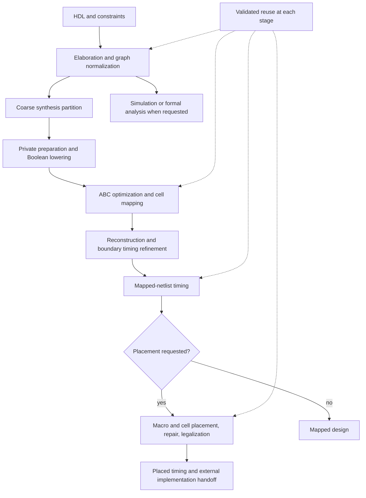

# LiveHD: algorithms of the default flow

**Draft methodology reference · source snapshot 2026-11-01.** This section
addresses readers familiar with synthesis, static timing analysis and physical
design. It describes the algorithms selected by the current driver, their
composition and their limits. The [LiveHD guide](../livehd/00-intro.md) defines
IR concepts and interfaces; the [Pyrope reference](../pyrope/01-introduction.md)
defines the language. Neither is repeated here.

## Abstract

LiveHD organizes hardware compilation around a hierarchical word-level graph
and reusable transformation units. The compiler first establishes explicit
width, state and connectivity semantics. Synthesis then selects a partition,
optimizes its Boolean realization, maps it to library cells and reconnects the
result under a common timing environment. Structural reuse avoids repeating
compatible work, while timing feedback reconnects decisions that partitioning
makes locally. The same compiled graph also supports simulation and formal
analysis. This organization follows the interactive-development motivation of
[LiveHD](80-references.md#livehd) and
[LiveSynth](80-references.md#livesynth); those publications provide historical
context, not a specification of every current implementation choice.

## 1. Scope and default policy

“Default” is conditional on the requested command and its inputs. A normal
`lhd synth` maps and times a design; it does **not** automatically place or route
it. The physical chapter describes the normal path **after placement is
explicitly enabled**. Libraries, timing constraints and floorplans remain part
of the problem definition.

| Decision | Current selection | Algorithmic consequence |
|---|---|---|
| Graph simplification | `compile.cprop.engine=aegraph` | Acyclic equivalence representation, eager rewriting and cost-based extraction |
| Extraction objective | `compile.aegraph.cost=auto` | Simulation cost under `lhd sim`; synthesis cost otherwise |
| Ordinary combinational inlining | `compile.upass.inline=false` | Preserve hierarchy unless a required structural repair dissolves it |
| Logical optimizer | `synth.mapper=abc` | ABC Boolean optimization followed by standard-cell mapping |
| Synthesis partition | `synth.partition=coarse` | Register-to-register cone profile; independent of the optimizer selection |
| Private synthesis preparation | Specialization, register merging, state observability sweep and clock gating enabled | Reduce and restructure the synthesis copy before mapping; clock gating requires a suitable library ICG |
| Timing | `synth.opentimer=true` | Analyze the mapped design after synthesis |
| Physical placement | `synth.place=false` | Physical optimization is a conditional extension |
| Persistent reuse | `lhd.incremental=true`, with a named work directory | Reuse only artifacts whose inputs and transformation context remain compatible |
| Simulator code generation | `sim.tune.backend=llvm` | Native object generation for simulation colors |

This is a small policy table, not an option catalog. In particular, compile-time
SAT optimization, whole-design compile flattening, uSyn, centroid floorplanning,
H2D macro placement and legroute are not implicit steps of this baseline.
Explicit profiling explores alternatives; the default synthesis profiling
policy replays compatible decisions rather than initiating that exploration.

## 2. Organization

The diagram shows dependencies, not a promise that every box executes on a
cache hit. Formal equivalence is an independently requested analysis, not an
automatic certificate attached to every synthesized or placed netlist.

## 3. Reading order

1. [Semantic normalization](01-normalization.md): the representation and
   invariants supplied to later algorithms.
2. [Synthesis decomposition](02-regions.md): cone ownership, sharing and the
   distinction between current coarse and optional fine partitions.
3. [Logic synthesis and technology mapping](03-synthesis.md): Boolean search,
   physical budgets and reconstruction.
4. [Conditional physical flow](04-physical.md): analytical placement, timing
   feedback, terminal legalization and the routing boundary.
5. [Incremental computation](05-incremental.md): reuse identity and invalidation.
6. [Simulation and verification](06-execution-verification.md): alternative
   consumers of the compiled graph and the scope of their evidence.

[References](80-references.md) separate algorithmic antecedents from current
implementation evidence. The [maintenance and migration appendix](90-maintenance.md)
records the reviewed source revision and the local documents this draft can
replace. Benchmark results, tuning histories and CLI inventories are outside
this methodology reference.
