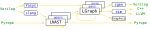

# Introduction

LiveHD is a compiler and development flow for **Pyrope and Verilog/SystemVerilog**.
It brings compilation, simulation, synthesis and formal verification together
behind the [`lhd` command](02-usage.md).

The goal of *live hardware development* is a short edit–check cycle: small
source changes should reuse prior work and return useful feedback in seconds.
This is a design goal, not a latency guarantee for every design or proof.

## Goal

LiveHD aims to make hardware development fast, approachable and trustworthy:

- **Fast feedback:** parallel work, reusable compilation artifacts and incremental
  synthesis and verification.
- **Useful diagnostics:** source locations carried through the intermediate
  representations into errors, counterexamples and timing reports.
- **Checked transformations:** regression tests, differential testing and
  equivalence checks that distinguish proofs from bounded or sampled results.

## LiveHD Framework

{ .flow-diagram }

The diagram is copied from the LiveHD repository's
[`docs/livehd.svg`](https://github.com/masc-ucsc/livehd/blob/master/docs/livehd.svg).

Two intermediate representations connect the flow. [LNAST](06-lnast.md) is the
language-neutral tree used for elaboration; [LGraph](05-lgraph.md) is the
hierarchical graph used for hardware optimization and execution. Both use
HHDS storage: `hhds::Tree` / `hhds::Forest` for LNAST and `hhds::Graph` /
`hhds::GraphLibrary` for LGraph.

1. **Read the source.** Pyrope enters through `inou/prp`. The default
   Verilog/SystemVerilog reader is native Slang (`inou/slang`); it also produces
   LNAST. The optional Yosys readers translate directly to LGraph.
2. **Elaborate LNAST.** The `upass/` pipeline resolves names and types, evaluates
   compile-time expressions and prepares hardware structure. `upass/tolg`
   lowers that structure to LGraph.
3. **Normalize the graph.** Constant propagation defaults to the acyclic
   e-graph engine (`pass.aegraph`), with classic `pass.cprop` available through
   `compile.cprop.engine`. Bitwidth inference and the remaining compile passes
   prepare the graph for downstream consumers.
4. **Run the requested flow.** `lhd synth` adds region synthesis, mapping and
   timing; `lhd sim` executes the design; `lhd lec` and `lhd formal verify`
   check equivalence and properties. Placement is optional, enabled with
   `synth.place=true`.
5. **Emit results.** Verilog is emitted from LGraph. Pyrope can be re-emitted
   from LNAST. Simulation uses LLVM by default, with the Slop C++ backend
   available explicitly.

## Supported inputs

The direct Chisel/FIRRTL frontend has been **removed**. LiveHD does not accept
FIRRTL as an input format. For a Chisel design, generate Verilog/SystemVerilog
with its own toolchain, then compile that RTL through a supported LiveHD
reader. Compatibility is determined by the generated RTL and reader support.

## Where to go next

| Task | Reference |
| --- | --- |
| Build and run LiveHD | [Installation](01-install.md), [usage](02-usage.md) |
| Understand the current algorithms | [Algorithm and flow reference](../lhd/index.md) |
| Work on an IR or pass | [C++ API](04-api.md), [creating a pass](11-pass.md) |
| Check a design or compare revisions | [Formal verification](07-formal.md) |
| Map a design and inspect timing | [Synthesis](08-synth.md) |
